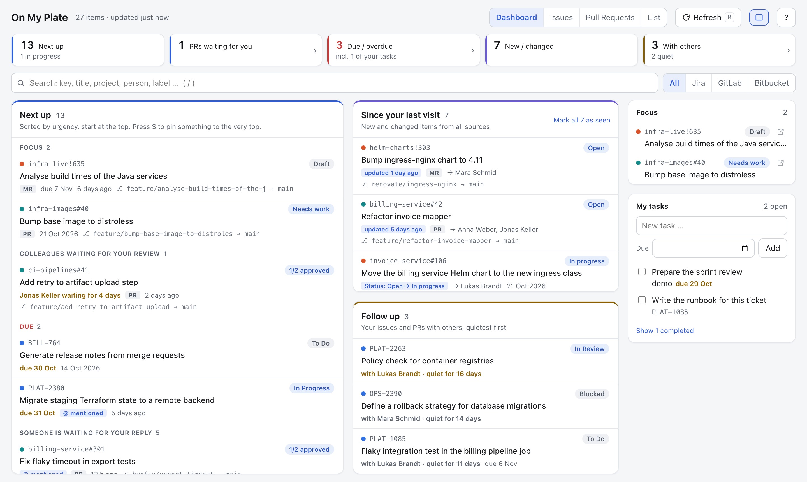
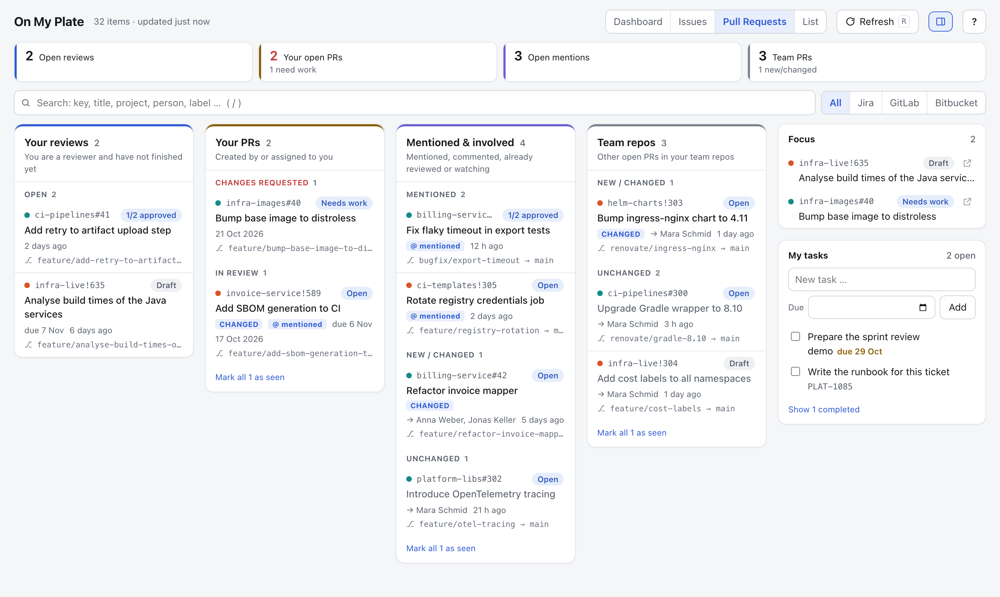
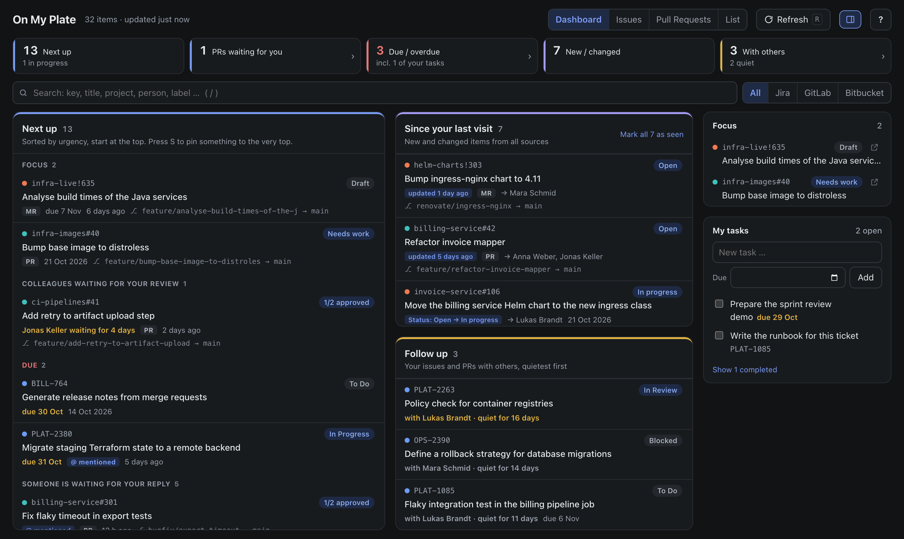

# On My Plate

**What's on your plate across Jira, GitLab and Bitbucket, in one local dashboard.**

[](https://github.com/Gr33ndev/OnMyPlate/actions/workflows/ci.yml)


[](LICENSE)

[Website](https://gr33ndev.github.io/OnMyPlate/) · [Live demo](https://gr33ndev.github.io/OnMyPlate/demo/) · [Quick start](#quick-start) · [Tokens](#tokens) · [Configuration](#configuration) · [Security](#security) · [Changelog](CHANGELOG.md)

On My Plate collects the issues and pull requests that concern you across all projects and instances, sorts them by what needs your attention, and keeps your own to-dos next to them. It is a single Python file with no dependencies. It runs on your laptop and only ever *reads* from your servers.



## Why

If you work across several Jira projects, GitLab groups and Bitbucket repositories, the question "what do I need to do next?" is spread over three tabs and a dozen filters. On My Plate answers it in one place:

- **Next up:** a ranked queue. It starts with your focus items, then changes requested on your PRs, colleagues waiting for your review (longest first), due items, unanswered mentions, and work assigned to you.
- **Since your last visit:** everything new or changed, including status transitions ("Status: Open → In Progress").
- **Follow up:** your issues and PRs that are with someone else, quietest first.

It is built for environments where data protection matters:

- Nothing is sent anywhere except read-only API calls to *your* instances.
- There is no cloud service, account, telemetry or third-party code.
- Tokens only need read scopes and are kept in your system keychain, never in a file. The HTTP client refuses to send anything other than reads.

## Features

- **Sources:**
  - Jira Data Center/Server and Jira Cloud.
  - GitLab self-managed and gitlab.com.
  - Bitbucket Data Center/Server.
  - Each source is optional.
- **What counts as "involved":**
  - Issues assigned to you, created by you, watched by you, commented on by you, mentioning you, or where your review is requested.
  - PRs/MRs you authored, are reviewing, were mentioned in or take part in.
  - Optionally all open PRs in your team's repos.
- **Four views:**
  - **Dashboard:** the overview described above.
  - **Issues:** a to do / waiting / watchlist board.
  - **Pull Requests:** your reviews, your PRs, mentions and team repos.
  - **List:** filter, group and sort.
- **Personal tasks** stored in a plain Markdown checklist (compatible with the Obsidian Tasks format). You can turn any ticket into a task, and edit the file by hand.
- **Focus list, private notes, "seen" tracking and "hide until something changes".** These live only on your machine.
- **Keyboard driven:** `J`/`K` to move, `O` to open in Jira/GitLab/Bitbucket, `S` to star, `X` to hide. Press `?` for the full list.
- **Portable:** `--export` and `--import` move your tasks and settings to a new laptop.
- **Light and dark theme** following your system.

<table><tr>
<td></td>
<td></td>
</tr></table>

## Quick start

You need Python 3.11 or newer. Nothing else.

```sh
curl -O https://raw.githubusercontent.com/Gr33ndev/OnMyPlate/main/onmyplate.py
python3 onmyplate.py --demo      # look around with sample data, no network access
python3 onmyplate.py             # first run writes onmyplate.config.json and explains it
```

Fill in the URLs in `onmyplate.config.json` and store each token in your system keychain with `python3 onmyplate.py --set-token gitlab` (or `jira`, `bitbucket`; the token is asked for and not shown). Then run `python3 onmyplate.py` again. Later changes to the config apply on the next refresh (`R`), no restart needed; **? → Sources** shows whether each source answered. Your browser opens and signs in automatically. For another browser, use the sign-in link printed in the console. It works once and expires after 15 minutes. Sessions end when On My Plate stops, so other browsers sign in again after a restart.

You can also install it as a command:

```sh
pipx install git+https://github.com/Gr33ndev/OnMyPlate
onmyplate --demo
```

When installed this way, data lives in `~/.onmyplate` instead of next to the script.

## Command line

| Option | Effect |
|---|---|
| *(none)* | Start the dashboard. On first run, write `onmyplate.config.json` and exit. |
| `--demo [SOURCES]` | Sample data, no network, throw-away data folder. Optionally limit sources: `--demo gitlab,bitbucket` |
| `--port N` | Port to listen on (default from the config, `8765`). `0` picks a free port. |
| `--no-browser` | Don't open the browser; use the sign-in link printed in the console. |
| `--data-dir DIR` | Folder for all data (default `$ONMYPLATE_HOME`, else next to the script or `~/.onmyplate`). |
| `--config FILE` | Use a config file outside the data folder. |
| `--set-token SOURCE` / `--delete-token SOURCE` | Store the token for `jira`, `gitlab` or `bitbucket` in the system keychain (asked for, not shown, or piped in), or remove it. |
| `--export ZIP` / `--with-config` | Write a backup (tasks and settings; with `--with-config` also the config, never tokens) and exit. |
| `--import ZIP` | Restore a backup and exit. Existing files are kept as `*.bak-<timestamp>`. |
| `--rotate-key` | New access secret: every browser has to sign in again. |
| `--licenses` | Show the license of On My Plate and of the third-party software it ships. |

## Tokens

Create tokens with **read access only**. On My Plate sees what your account sees and nothing more.

| Source | Token | Scope / permissions |
|---|---|---|
| Jira Data Center / Server (8.14+) | Personal access token: avatar → Profile → Personal Access Tokens | Same permissions as your account (PATs have no scopes) |
| Jira Cloud | API token with scopes, plus your e-mail in `jira.email` | `read:jira-work`, `read:jira-user` |
| GitLab | Personal access token | `read_api` |
| Bitbucket Data Center | **Personal** HTTP access token: Profile → Manage account → HTTP access tokens. Project or repository tokens act as their own bot user and cannot see your dashboard. | Project read, Repository read |

**Tokens are never stored in plain text.** On My Plate keeps them in the keychain of your system, one entry per source and host:

| System | Keychain |
|---|---|
| macOS | Keychain (`security`, built in) |
| Linux | Secret Service, e.g. GNOME Keyring or KWallet, through `secret-tool` (package `libsecret-tools` or `libsecret`) |
| Windows | Credential Manager |

```sh
python3 onmyplate.py --set-token gitlab      # asks for the token, stores it for the host in gitlab.url
python3 onmyplate.py --delete-token gitlab
```

A token is stored for the host of the configured URL and is never sent anywhere else, even if the URL changes. Older configs that still contain a `"token"` are cleaned up on the next start: the token moves into the keychain and disappears from the file.

Two alternatives, for example on a server without a keychain:

- `"token_command"` in a source's config: a command that prints the token, such as a password manager CLI (`"op read op://Private/GitLab/token"`, `"pass show gitlab"`). It runs once per start, without a shell.
- The environment variables `ONMYPLATE_JIRA_TOKEN`, `ONMYPLATE_GITLAB_TOKEN` and `ONMYPLATE_BITBUCKET_TOKEN`.

Without a keychain, a token in the config file is refused instead of being stored in plain text.

"You" is always the owner of the token. On My Plate asks each server who that is (`/myself`, `/user`, the `X-AUSERNAME` header) and uses no separate user setting.

## How "involved" is detected

| | Jira | GitLab | Bitbucket |
|---|---|---|---|
| Assigned / created / watching | JQL `assignee`, `reporter`, `watcher` | `scope=assigned_to_me`, `created_by_me` (GitLab has no API to list items you are subscribed to) | n/a |
| Commented | Data Center: built-in activity stream. Cloud: `updatedBy()` | Events API | n/a |
| Mentioned | n/a | GitLab to-dos (`mentioned`, `directly_addressed`) | Scans comments of recent open PRs for `@you` |
| Reviews / your PRs | n/a | `reviewer_id`, `created_by_me`, `assigned_to_me` | Dashboard API, roles `REVIEWER`, `AUTHOR`, `PARTICIPANT` |
| Team repos | n/a | `watch_projects` (project or group) | `watch_repos` (`PROJ` or `PROJ/repo`) |

On Bitbucket a mention counts as answered once you comment after it, on GitLab once its to-do is done. GitLab work items (tasks, epics, objectives and the like, GitLab 17+) count as issues. Answered mentions move from "Mentioned" to the watchlist.

## Configuration

`onmyplate.config.json` is created on first run. [`onmyplate.config.example.json`](onmyplate.config.example.json) shows every option with its default.

| Option | Default | Meaning |
|---|---|---|
| `port` | `8765` | Local port (always bound to 127.0.0.1) |
| `refresh_minutes` | `10` | Background refresh interval |
| `verify_ssl` / `ca_bundle` | `true` / `null` | For an internal CA, point `ca_bundle` at its PEM file instead of disabling verification |
| `timeout_seconds` | `30` | Per request |
| `<source>.enabled` | `true` | Set `false` for sources you don't use |
| `<source>.token_command` | `null` | Command that prints the token, e.g. a password manager CLI; instead of the keychain |
| `jira.type` | `"auto"` | `*.atlassian.net` is Cloud; anything else is Data Center. Force with `"server"` or `"cloud"` |
| `jira.scope_jql` | `""` | Extra JQL ANDed to every query, e.g. `project in (PLAT, OPS)` |
| `jira.participation_jql` | `null` | Custom JQL for "involved", e.g. a ScriptRunner `issueFunction in commented("by currentUser()")` |
| `jira.include_done`, `gitlab.include_closed`, `bitbucket.include_closed` | `false` | Also show finished work |
| `gitlab.watch_projects` | `[]` | Projects or groups whose open MRs appear under Team repos |
| `bitbucket.watch_repos` | `[]` | `PROJ` or `PROJ/repo` whose open PRs appear under Team repos |
| `bitbucket.username` | `""` | Only needed if your server does not send `X-AUSERNAME` |
| `*_lookback_days`, `max_*` | various | Bound how far back and how much On My Plate reads |

## Your data

Everything lives in one folder: next to the script, `~/.onmyplate` for package installs, or `--data-dir` / `$ONMYPLATE_HOME`.

| File | Contents |
|---|---|
| `onmyplate.config.json` | URLs and settings, no tokens |
| `onmyplate.local.json` | Focus list, notes, seen state, hidden items |
| `onmyplate.todos.md` | Your tasks as a Markdown checklist, safe to edit by hand |
| `onmyplate.secret` | Secret that browser sessions are derived from |

Ticket data is held in memory only and never written to disk.

**Moving to a new machine:**

```sh
python3 onmyplate.py --export onmyplate-backup.zip          # tasks and settings, no tokens
python3 onmyplate.py --import onmyplate-backup.zip          # on the new machine
```

`--with-config` also packs the config. Tokens stay in the keychain and are never exported: store them again on the new machine with `--set-token`. On import, existing files are kept as `*.bak-<timestamp>`.

## Security

On My Plate is designed so that a hostile web page in the same browser, another user on the same machine, or a compromised server response cannot get at your tokens or data:

- **Server:**
  - Binds to 127.0.0.1.
  - Checks `Host`, `Origin` and `Sec-Fetch-Site` against DNS rebinding and cross-site requests.
  - Each browser signs in with a one-time link. Sessions end when On My Plate stops, so a token that leaks from browser storage is useless after a restart.
  - API calls then carry a session token in a header. Browsers never attach such a header on their own, and other origins (including other ports on localhost) cannot read it.
  - Tokens are kept in the system keychain, bound to the host of the configured URL, and never written to a file.
  - On My Plate refuses a config file that another user could change (writable by group or others, owned by someone else, or in a folder others can write to), because the config decides where tokens are sent.
- **Page:**
  - A strict Content Security Policy that allows only the page's own script, identified by its hash.
  - Framing is forbidden.
  - All server data is escaped, and links are restricted to your configured instances.
- **HTTP client:**
  - Only GET, plus the read-only Jira search POST.
  - HTTPS only.
  - Redirects to other hosts are refused, so tokens never leave for another host.
  - Bounded response sizes and times.
  - XML with DTDs is rejected.
- **Files** are written atomically with mode 0600. `--rotate-key` signs out every browser.

See [SECURITY.md](SECURITY.md) for how to report a vulnerability.

## Limitations

- **Jira Data Center comment detection** relies on the activity stream accepting your personal access token. If it doesn't, On My Plate shows a notice. In that case set `participation_jql` if your instance has a plugin such as ScriptRunner.
- **GitLab's events API** is most reliable for issue comments. Merge request involvement mostly comes from reviews, mentions and to-dos.
- **Bitbucket has no mention search.** On My Plate scans the comments of recently updated open PRs it already knows about (`max_mention_scans`) and caches results until the PR changes.
- **It is a personal tool.** One user, one machine, read-only. It cannot close tickets or approve PRs; press `O` to jump to the real thing.

## Development

The project is one file on purpose. [CONTRIBUTING.md](CONTRIBUTING.md) explains the ground rules, [AGENTS.md](AGENTS.md) describes the code layout and conventions for AI coding agents and newcomers alike.

```
onmyplate.py               the whole tool, including the embedded web UI
tests/                     unittest suites with fake Jira, GitLab and Bitbucket servers
tools/ui.py                extract / embed the web UI for editing
docs/                      screenshots and the GitHub Pages site
.github/workflows/         CI (tests on Python 3.11-3.14, ruff, bandit, ESLint) and Pages
```

The UI is embedded in `onmyplate.py` so the tool stays a single file. To work on it as a normal HTML/JS file:

```sh
python3 tools/ui.py extract     # writes build/ui.html and build/app.js
# edit build/ui.html
python3 tools/ui.py embed       # writes it back into onmyplate.py
python3 tools/ui.py demo        # writes docs/demo/index.html, the browser-only demo
python3 tools/screenshots.py    # retakes docs/*.png from the real UI (needs Chrome)
git config core.hooksPath tools/hooks   # commit message, ruff and test hooks
```

The [live demo](https://gr33ndev.github.io/OnMyPlate/demo/) is served by the same code as the real tool. The build runs `onmyplate.py` in demo mode, records the page and every API answer the UI can ask for, and the page replays them in the browser. A test sends the same requests to the real server and to the demo and fails on any difference. The Pages workflow runs the tests and rebuilds the demo on every deploy.

Checks, as run in CI:

```sh
python3 -m unittest discover -s tests
ruff check . && ruff format --check .
bandit -q -c pyproject.toml onmyplate.py
npm ci && npm run lint          # ESLint on the embedded UI
python3 tools/third_party_licenses.py --check   # license notices up to date
```

No ruff or bandit installed? `uvx ruff check .` and `uvx bandit ...` run them without installing. The tests run against local fake servers, so they need no network access and finish in a few seconds.

## License

On My Plate is licensed under the [MIT License](LICENSE). It ships no third-party code: [THIRD_PARTY_LICENSES.md](THIRD_PARTY_LICENSES.md) is generated from the runtime dependencies by `tools/third_party_licenses.py` and checked in CI, and [NOTICE](NOTICE) has the remaining notes on trademarks and the task file format. The app shows all of it under **? → About & licenses**, and `python3 onmyplate.py --licenses` prints it.
